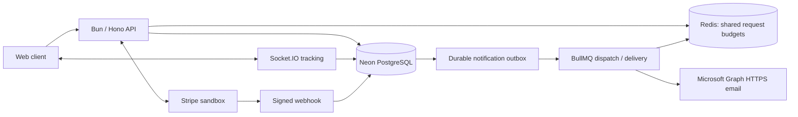

# ISOTrack Backend

ISOTrack helps delivery businesses manage their own driver fleets, shipment
operations, customer tracking and shipment payments. A business invites drivers,
assigns work and follows a shipment through delivery or return. Customers can
view shipments linked to their account; recipients can follow a limited public
tracking view without receiving private shipment or account data.

This repository contains the HTTP API, real-time tracking server, database
migrations, background delivery processes and operational tooling. The frontend
is maintained separately. Current development focuses on completing and verifying
the backend before adapting the frontend to the updated contracts.

## Project status

ISOTrack is a portfolio project developed with production engineering practices
on a zero-spend infrastructure budget. It is not a claim of production capacity
or an always-available commercial service.

- Driver enrollment uses **business invitations and one fleet membership at a
  time**. Public driver signup is blocked.
- Payments use **Stripe sandbox only**, including publicly hosted portfolio
  deployments. Live keys are rejected. Payment support does not include business
  payouts, normal applied-payment refunds, partial refunds or disputes.
- The existing `main` deployment remains separate from the updated preview.
  Its frontend behavior does not establish compatibility with this branch.
- Hosted database restore and application recovery checks have passed within
  their documented scope. The first hosted performance baseline **failed** on
  read timeouts; diagnosis is still open.

See the [readiness register](docs/production-readiness.md) for dated results,
failures, remaining gates and evidence boundaries. Older entries describe the
state at the time they were written; use the latest relevant verification entry.

## Product workflows

| Area                | Behavior                                                                                                                        |
| ------------------- | ------------------------------------------------------------------------------------------------------------------------------- |
| Private fleets      | Owners issue, list and revoke invitations; enrollment checks recipient identity and membership.                                 |
| Shipment operations | Creation, assignment, versioned status changes, cancellation, failed delivery and return custody.                               |
| Delivery proof      | Recipient confirmation codes, expiry and attempt controls; ordinary status updates cannot bypass confirmation.                  |
| Payments            | Stripe Checkout, signed callbacks, single applied receipts, reconciliation and operator resolution of received review balances. |
| Tracking            | Authenticated driver location updates and participant subscriptions; a separate minimal public tracking projection.             |
| Identity            | Login, revocable sessions, refresh rotation/reuse handling, credential recovery and verification flows.                         |
| Notifications       | Transactional PostgreSQL outbox, in-app/email delivery, bounded retries, dead letters and replay tooling.                       |
| Operations          | Health probes, structured logs, private metrics, retention controls, migrations, recovery and performance tooling.              |

Authorization is checked against current ownership, fleet membership or assignment,
not merely a client-supplied role. Shipment commands use expected versions and
idempotency keys. Database constraints and atomic writes protect state/history
consistency when requests race, fail or are retried.

## Architecture



PostgreSQL owns shipment state, events, financial records, sessions, idempotency
results and durable notification work. Redis supports shared request budgets and
queue delivery; it is not the only copy of pending notification work. Workers
need an active process to make progress. Sleeping free hosting does not provide
continuous dispatch.

The application uses the Neon HTTP driver. Disposable PostgreSQL in tests is
accessed through test adapters where documented; a plain local PostgreSQL URL is
not a drop-in replacement for the application's Neon HTTP connection.

**Stack:** TypeScript, Bun, Hono, PostgreSQL/Neon, Drizzle ORM and SQL migrations,
Redis, BullMQ, Socket.IO, Stripe SDK, MSAL Node, Zod, jose, Prometheus metrics and
GitHub Actions. Email uses an authorized personal Outlook mailbox through Microsoft Graph HTTPS. See docs/microsoft-graph-email.md.

## Local setup

### Requirements

- Node.js **24.12.0** and Bun **1.3.12**, matching the CI configuration.
- A separate development Neon database and a reachable Redis service.
- Docker for the integration suites, local recovery drill and monitoring fixtures.
- An authorized Outlook sender if you intend to exercise external email delivery.

All commands below run from this repository root. Never use a live database as
your development or test destination.

### Install and configure

For isolated local dashboard development, use the [Docker setup](docs/local-docker.md)
instead of a hosted database. It provides persistent localhost-only PostgreSQL and
Redis plus a guarded local adapter. The steps below describe the Neon setup used
by hosted environments.

```sh
bun install --frozen-lockfile
```

Copy `.env.example` to `.env` using your editor, then replace the placeholders
privately. The example is a configuration reference, not working credentials.

| Setting                                                                         | Purpose                                                                               |
| ------------------------------------------------------------------------------- | ------------------------------------------------------------------------------------- |
| `DATABASE_URL`                                                                  | Development Neon PostgreSQL connection, including its TLS parameters.                 |
| `UPSTASH_REDIS_URL`                                                             | Redis connection; despite the variable name, Render Key Value is also supported.      |
| `JWT_SECRET`, `JWT_REFRESH_SECRET`                                              | Independently generated signing secrets, at least 32 characters each.                 |
| `APP_URL`, `FRONTEND_URL`                                                       | Backend and trusted frontend origins for this environment.                            |
| `MICROSOFT_MAIL_CLIENT_ID`, `MICROSOFT_MAIL_SENDER`, `MICROSOFT_MAIL_CACHE_KEY` | Microsoft app ID, personal Outlook sender and independent cache encryption key.       |
| `NOTIFICATION_WORKERS_ENABLED`                                                  | Set `false` initially so restored or pending work is not dispatched unexpectedly.     |
| `STRIPE_MODE`                                                                   | Keep `disabled` until deliberately configuring the sandbox integration.               |
| `RETENTION_ENABLED`                                                             | Keep `false` until reviewing the retention policy and dry-run results.                |
| `DELIVERY_CODE_SECRET`                                                          | Independent 32-byte hex key for delivery proof; blank disables issuance/confirmation. |
| `ACCOUNT_ACTION_SECRET`                                                         | Independent 32-byte hex key for recovery/verification email links.                    |
| `METRICS_TOKEN`                                                                 | Optional independent 32–128 character URL-safe token; blank disables `/metrics`.      |

`NOTIFICATION_WORKERS_ENABLED` defaults to `true` in code, so set it explicitly
when starting an isolated environment. Outlook settings may stay blank while workers are disabled. Apply migration 0019 and authorize the sender before enabling workers. Configuration does not prove delivery.

Generate fresh secrets locally; do not reuse preview/live keys. Keep `.env`,
private operator files, tokens, database dumps and backup keys out of Git. Leave
`TRUSTED_PROXY_IPS` blank for direct local requests. Hosted proxy trust requires
verified immediate proxy addresses and header behavior, not a wildcard.

### Migrate and start

```sh
bun run db:migrate
bun run dev
```

The default backend port is `8000`. Check `GET /health/live` and
`GET /health/ready` before testing application requests. Authentication endpoints
are under `/api/v1/auth`; business accounts can invite drivers through the private
fleet workflow. There are no published shared credentials.

Use checked-in migrations rather than `db:push` for a managed environment. A
copied schema with empty migration history needs review; do not invent migration
ledger entries to make startup pass. See [migrations](docs/migrations.md) and
[private fleet migration requirements](docs/private-fleets.md).

## API and client integration

**Start with Swagger:** run `bun run docs:serve` and open
[the read-only reference](http://127.0.0.1:8001/docs/) without backend credentials.
When the configured API is running, [interactive Swagger](http://localhost:8000/docs/)
and [the OpenAPI endpoint](http://localhost:8000/openapi.json) use its actual origin/port.
The checked-in [OpenAPI contract](docs/openapi.json) can be imported into client tools.
See the [API integration guide](docs/api-reference.md) for authentication, cookies,
workflows, Socket.IO and contract maintenance. Cookie refresh/logout must be tested
from the configured trusted frontend origin, as explained in the guide.

All application HTTP routes use `/api/v1`. This table identifies route groups;
the OpenAPI contract defines HTTP payloads and authorization, and the linked
documents explain operational details.

| Prefix                       | Purpose                                                          | Contract                                                                                                                 |
| ---------------------------- | ---------------------------------------------------------------- | ------------------------------------------------------------------------------------------------------------------------ |
| `/api/v1/auth`               | Identity, sessions and account actions                           | [Sessions](docs/sessions.md), [recovery](docs/account-recovery.md)                                                       |
| `/api/v1/driver-invitations` | Private fleet invitations and enrollment                         | [Invitations](docs/driver-invitations.md)                                                                                |
| `/api/v1/shipments`          | Shipment reads, commands, history, exceptions and delivery proof | [Commands](docs/shipment-commands.md), [delivery](docs/delivery-confirmation.md), [returns](docs/shipment-exceptions.md) |
| `/api/v1/drivers`            | Fleet discovery and driver operations                            | [Private fleets](docs/private-fleets.md)                                                                                 |
| `/api/v1/business`           | Business profile and analytics                                   | [Response privacy](docs/shipment-response-privacy.md)                                                                    |
| `/api/v1/payments`           | Checkout, verification, cancellation and signed webhook          | [Payments](docs/payments.md)                                                                                             |
| `/api/v1/track/:trackingId`  | Limited public shipment tracking                                 | [Tracking privacy](docs/tracking-history.md)                                                                             |
| `/api/v1/notifications`      | Authenticated notification access                                | [Notifications](docs/notifications.md)                                                                                   |

The browser sends access tokens as Bearer credentials. Refresh/logout use the
refresh cookie and require the configured trusted `Origin`; CORS alone is not
authorization. A client must retain the same `Idempotency-Key` when retrying the
same logical write and send the expected shipment version for commands. Changing
the request body requires a new operation/key. See [idempotency](docs/idempotency.md).

Socket.IO authentication and event permissions are separate from public HTTP
tracking. See [real-time tracking](docs/tracking.md) before implementing clients.

## Testing and evidence

```sh
bun run lint
bun run type-check
bun run build
bun run test:unit
bun run test:integration
```

The integration command needs Docker and sufficient resources for disposable
services. Bun must be available on PATH for assembled-app tests; the relevant
fixtures also accept `BUN_EXECUTABLE`. Images may need downloading on first use.

| Layer                          | What it establishes                                                                                                                                           |
| ------------------------------ | ------------------------------------------------------------------------------------------------------------------------------------------------------------- |
| Fast tests                     | Validation, token/signature handling, handler behavior, failure boundaries and tooling rules.                                                                 |
| Real-service integration       | PostgreSQL transactions/constraints, Redis budgets/queues, races, rollback and injected failures; HTTP, sockets and a local Graph HTTP fixture where covered. |
| Assembled application journeys | Real Bun entrypoint and authentication with disposable services; vendor transport substitutions are stated in the test documentation.                         |
| Hosted/provider exercises      | Explicit preview checks, actual Stripe sandbox behavior and hosted recovery; separate private configuration and evidence.                                     |

The test runner produces JUnit and JSON reports under ignored `reports/` and
rejects empty results, failures, cancellations, skips and todos. Test code being
present does not mean its latest execution passed. Consult [test coverage and
boundaries](tests/README.md), [CI](docs/ci.md) and the [readiness register](docs/production-readiness.md).

Operational exercises are opt-in, not commands to run casually against any URL:

| Command                                        | Scope and prerequisites                                                                                                                   |
| ---------------------------------------------- | ----------------------------------------------------------------------------------------------------------------------------------------- |
| `bun run test:load`                            | Local synthetic PostgreSQL benchmark; no existing application database.                                                                   |
| `bun run recovery:drill`                       | Disposable local logical backup/restore drill.                                                                                            |
| `bun run recovery:smoke`                       | Full app HTTP checks against the isolated hosted recovery database; private config, successful restore evidence, Bun and Docker required. |
| `npm run test:load:hosted -- FULL_PREVIEW_SHA` | Bounded preview traffic and synthetic writes; requires isolation config and exact release identity.                                       |

Read [performance](docs/performance.md) and [recovery](docs/recovery.md) first.
Hosted exercise reports include failed attempts. They are not interchangeable
with ordinary CI tests or proof of production-scale traffic.

## CI and release workflow

| Branch                    | Purpose                                                                |
| ------------------------- | ---------------------------------------------------------------------- |
| `isoTrack-dev-branch`     | Active backend development.                                            |
| `isotrack-preview-branch` | Reviewed releases for the separate Render preview service.             |
| `main`                    | Existing public deployment; promote changes deliberately after review. |

GitHub Actions runs lint, types, build, fast tests and three disjoint integration
groups. The final `checks` job is the combined gate. Reports are uploaded for
14 days; expiration removes test evidence, not application data or functionality.
Branch protection and environment secrets are repository settings, not configured
merely by checking in the workflow file.

Preview pushes also require guarded database preparation. Render uses Docker and
**After CI Checks Pass** deployment. Hosted smoke verification runs afterward,
outside the CI checks Render awaits. Render rebuilds the source; this is not a
claim that CI's exact tested container image digest is promoted unchanged.

See [preview deployment](docs/preview-deployment.md) for the full sequence,
environment separation and rollback considerations. Never point preview at live
PostgreSQL/Redis or reuse live signing/provider secrets.

## Monitoring and recovery

| Endpoint              | Meaning                                                                               |
| --------------------- | ------------------------------------------------------------------------------------- |
| `GET /health/live`    | Process responds; no dependency check.                                                |
| `GET /health/ready`   | Required database schema is queryable and the process is not draining; otherwise 503. |
| `GET /health/release` | Environment and release SHA.                                                          |
| `GET /metrics`        | Token-protected Prometheus exposition; 404 when disabled.                             |

Readiness is not a full customer journey check and does not establish Redis,
Microsoft Graph or Stripe availability. Protected endpoints can fail closed with 503 when
Redis request protection is unavailable even while database readiness is healthy.

Logs use structured events and request IDs. Prometheus/Alertmanager configuration
is under `monitoring/`; the shipped receiver needs an explicit notification
destination. Check [observability](docs/observability.md) for tokens, rollout,
alerts and limitations.

Recovery has been exercised against a separate hosted database, including exact
table comparisons and subsequent local full-app HTTP checks. This does not prove
automatic failover, independently retained scheduled backups or public traffic
cutover. Restored sessions, pending notifications and provider state need review
before reconnecting a recovered system. See the [recovery runbook](docs/recovery.md).

## Repository layout

```text
src/routes/          HTTP contracts and authorization boundaries
src/services/        Application workflows, write coordination and reconciliation
src/db/              Schema, queries, migration runner and operator commands
src/socket/          Real-time protocol and shipment access checks
src/workers/         Durable notification and email delivery
src/observability/   Health, metrics and structured telemetry
drizzle/             Versioned SQL migrations and metadata
tests/               Fast, integration and assembled-app verification
scripts/             Report validation, release, recovery and performance tooling
monitoring/          Local Prometheus and Alertmanager configuration
docs/                Contracts, runbooks and dated readiness evidence
.github/workflows/   CI and manual local performance workflow
```

## Current engineering work

The backend contract is frozen for the first frontend integration slice. Start
with the [frontend handoff](docs/frontend-handoff.md) and the finite
[backend closeout checklist](docs/backend-closeout.md). The candidate adds
password-confirmed [account deactivation](docs/account-deactivation.md) and bounded
fleet/notification collections; deploy migrations 0016–0017 to preview before
browser acceptance. Main/live are not changed by the development work.

The first hosted load run had two 10-second read timeouts at one offered
operation/second. Further traffic stopped; no maximum capacity was established.
Low-rate diagnostics now record request IDs and compare liveness,
readiness and authenticated operations, without assuming a code or hosting cause.

Other open gates include frontend adoption of the new contracts, public deployment
recovery/cutover, backup scheduling and independent retention, confirmed external
alert delivery, broader notification policy and representative capacity tests.
The project does not claim support for millions of concurrent users based on
local benchmarks or a small free-tier preview. Refer to the readiness register
before making a release decision.
